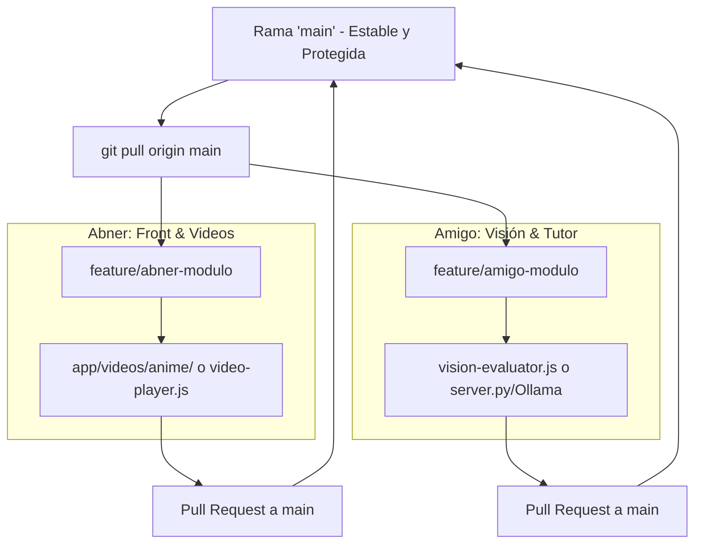

# AGENTS.md — Reglas y Contexto Técnico para Agentes de IA (Proyecto EXIS)

Este documento es de **lectura obligatoria para cualquier Agente de IA** (Google Antigravity, Claude Code, Cursor, Copilot, etc.) que trabaje en este repositorio. Define la arquitectura, reglas duras, contexto de hardware y protocolo de colaboración en equipo.

---

## 1. Identidad y Misión del Proyecto
- **Proyecto:** EXIS — Tutor Inteligente Interactivo para Lengua de Señas Colombiana (LSC).
- **Dataset Oficial:** LSC70 (Universidad Tecnológica de Pereira - UTP).
- **Paradigma de Visualización:** **Rama de Video Interactivo (HTML5 + WebP)**.
  *(Nota crítica: NO usar avatares 3D ni armaduras Three.js/VRoid; fueron descartados porque el rigging de dedos no logra la precisión anatómica requerida en lengua de señas).*
- **Stack Técnico:**
  - **Frontend:** HTML5 semántico, Tailwind CSS (CDN), CSS customizado con variables (`app/css/styles.css`), JavaScript modular nativo ES6+.
  - **Visión Artificial:** Google MediaPipe Hands (CDN) para tracking de 21 landmarks de mano en tiempo real (30 fps) vía webcam.
  - **Tutor Inteligente:** Ollama local con modelo `qwen2.5:3b` mediante proxy HTTP en `server.py` (`/api/chat`).
  - **Servidor:** Servidor Python `server.py` con mapeo MIME (`.mp4`, `.webp`, `.webm`) en puerto 8000.

---

## 2. Reglas Duras de Desarrollo (Hard Rules)

Cualquier cambio de código debe cumplir **estrictamente** con estas 6 reglas:

1. **Límite de Líneas:** Ningún archivo de código puede superar las **1,100 líneas**. Si un módulo crece, debe subdividirse en submódulos independientes.
2. **Cero CSS y Cero JS Embebido en HTML:** En [`app/index.html`](file:///app/index.html) está estrictamente prohibido usar etiquetas `<style>` o escribir código dentro de `<script>`. Solo se permiten referencias externas `<link rel="stylesheet">` y `<script src="...">`.
3. **Servidor y Puerto Único (8000):** La aplicación corre exclusivamente en `http://localhost:8000/`. Nunca cambiar a puertos alternos (8080, 8088, 8899) sin matar primero procesos huérfanos.
4. **Doble Salida Multimedia (MP4 + WebP):** Cada seña en `app/videos/real/` y `app/videos/anime/` debe tener archivo `.mp4` y su gemelo `.webp` animado a 25 fps continuo (2.0 segundos, 50 frames). Esto asegura 100% de reproducción cruzada si el navegador bloquea autoplay de video.
5. **Accesibilidad y Contraste WCAG AAA:** Mantener la paleta oscuro/ámbar (`#0a0e17`, `#121824`, `#f59e0b`), tamaño de botones táctiles $\ge 44\text{px}$, y cero desbordamientos horizontales (`scrollWidth == clientWidth`) en 390x844 (móvil) y 1280x850 (escritorio).
6. **Verificación Visual Antes de Commit:** Antes de declarar una tarea como finalizada, el agente debe verificar que la app cargue sin errores en la consola (`window.__consoleErrors == []`).

---

## 3. Especificación de Hardware y Optimización

### Máquina de Colaboración (Nodo 2):
- **CPU:** AMD Ryzen 7 7440 (8 núcleos, 16 hilos)
- **RAM:** 16 GB DDR5
- **GPU:** NVIDIA GeForce RTX 4050 Laptop (6 GB VRAM GDDR6)

### Recomendaciones para el Agente en esta Máquina:
- **Ollama en GPU:** La RTX 4050 cuenta con 6 GB de VRAM. El modelo `qwen2.5:3b` ocupa **~1.9 GB de VRAM**, lo cual permite que corra **100% offloaded en GPU** sin saturar la RAM del sistema. Alcanza entre 90 y 130 tokens/segundo.
- **MediaPipe Hands:** Se ejecuta con aceleración por hardware WebGL/WebGPU en Chrome/Edge, consumiendo menos del 5% de CPU.
- **Generación Local de Videos con OpenCV:** Los 8 núcleos de Ryzen 7 7440 permiten generar interpolaciones ópticas (`cv2.DISOpticalFlow`) a alta velocidad.

### Comandos de Instalación para el Agente / Terminal (Windows):
Si en la máquina del compañero falta alguna herramienta, el agente o usuario puede instalarla en 1 minuto vía PowerShell:
```powershell
# 1. Instalar Git y GitHub Desktop
winget install --id Git.Git -e
winget install --id GitHub.GitHubDesktop -e

# 2. Instalar Ollama y descargar el modelo del tutor LSC
winget install Ollama.Ollama -e
ollama pull qwen2.5:3b

# 3. Instalar Python (3.11+)
winget install Python.Python.3.11 -e

# 4. Probar que Ollama esté respondiendo en GPU
curl http://localhost:11434/api/tags
```

---

## 4. Protocolo de Colaboración en Pareja (Evitar Choques)

Para trabajar en pareja sin sobreescribirse cambios ni generar conflictos de merge (*merge conflicts*):



### Reglas de Oro de Colaboración:
1. **Separación de Dominios por Módulo:**
   - **Desarrollador 1 (Abner):** Interfaz visual, estilos, catálogo de señas (`signs-data.js`), reproductor (`video-player.js`) y generación de clips Anime IA (`app/videos/anime/`).
   - **Desarrollador 2 (Amigo):** Evaluador de visión (`vision-evaluator.js`), precisión angular de MediaPipe, backend / tutor de Ollama (`server.py`, `chat-tutor.js`).
2. **Ciclo de Trabajo Git:**
   - Nunca hacer commits directos sobre `main`.
   - Crear rama de trabajo: `git checkout -b feature/<nombre>-<tarea>`
   - Antes de iniciar el día: `git checkout main && git pull origin main`
   - Al terminar una función: probar localmente en `http://localhost:8000/`, verificar 0 errores y hacer push a su rama.
3. **Dataset pesado (`LSC70/` y `LSC70.zip`):**
   - El dataset original de 1 GB está en `.gitignore`.
   - Todos los videos procesados y las muestras necesarias ya están incluidos en `app/videos/` y `app/dataset_samples/`, por lo que el repositorio clona en segundos (< 35 MB) y corre inmediatamente sin instalaciones complejas.

---

## 5. Estructura de Directorios

```text
exis-lenguaje-senas/
├── AGENTS.md                  # Reglas y contexto para agentes IA
├── README.md                  # Documentación de instalación y uso
├── server.py                  # Servidor HTTP + Proxy Ollama (puerto 8000)
├── iniciar_aplicacion.bat     # Lanzador de 1-clic para Windows
├── .gitignore                 # Exclusión de dataset pesado y temporales
├── app/
│   ├── index.html             # UI accesible (0 estilos/scripts en línea)
│   ├── css/
│   │   └── styles.css         # Tokens de diseño oscuro/ámbar y responsive
│   ├── js/
│   │   ├── signs-data.js      # Diccionario de 11 señas oficiales
│   │   ├── video-player.js    # Reproductor HTML5 + WebP fallback
│   │   ├── vision-evaluator.js# MediaPipe Hands y lógica de acierto
│   │   ├── chat-tutor.js      # Chat con Ollama y síntesis de voz
│   │   └── main.js            # Orquestación de eventos de la app
│   ├── dataset_samples/       # Fotos clave de referencia LSC70
│   ├── videos/
│   │   ├── real/              # 44 videos (MP4 + WebP) de persona real
│   │   └── anime/             # Destino para videos generados con IA
│   └── tools/                 # Scripts de generación y verificación
└── referencias_para_gemini/
    ├── fotos/                 # 11 fotogramas clave de máxima expresión
    └── PROMPTS_GEMINI.md      # Prompts bilingües para Gemini Web / Veo
```
