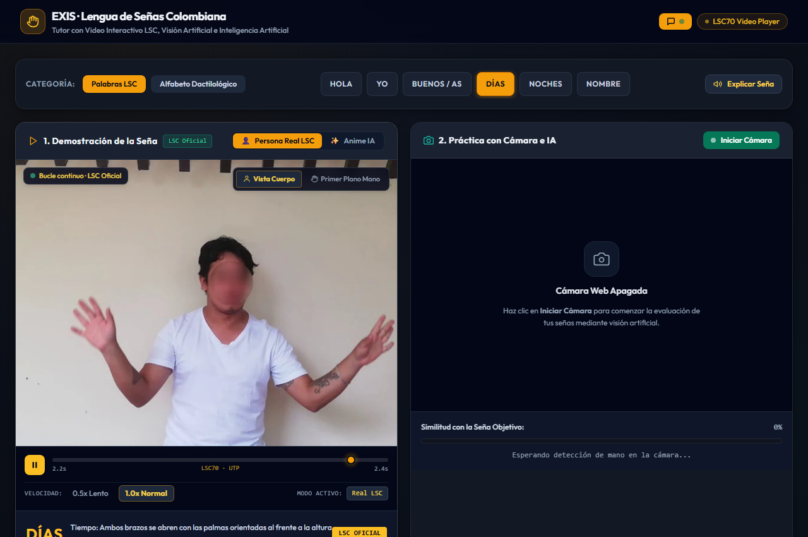

# 🤟 Manitas · Academia Interactiva de Lengua de Señas Colombiana (LSC)

Aplicación web educativa e interactiva (**Proyecto EXIS**) basada en el corpus oficial **LSC70** (Universidad Tecnológica de Pereira). Combina demostración multimedia híbrida (**Persona Real LSC** y **Anime**), evaluación biomecánica en tiempo real con **Google MediaPipe Hands + Pose**, práctica dactilológica guiada en el **Laboratorio ABC**, gamificación con medallas y repetición espaciada **SRS (Leitner)** 100 % en local (*offline-first*, sin modelos de lenguaje externos ni Ollama).



---

## 🌟 Módulos y Características Principales

1. **Mi Ruta de Aprendizaje (`?screen=path`)**
   - Mapa hexagonal interactivo por niveles con desbloqueo progresivo.
   - Rutas predefinidas (**Desde Cero**, **Abecedario**, **Palabras**), rutas recomendadas desde el onboarding (`/api/plan` determinístico) y constructor manual **+ Mi Ruta**.
   - **Lecciones en 4 fases** (`LessonSessionController`): Demostración → Quiz de reconocimiento → Práctica frente a cámara (o alternativa sin cámara) → Resumen con XP.
   - **Modo Examen (`BlindExamController`)**: evaluación sin videos guía en dos modalidades: **Solo Cámara** y **Adivinar Señas**.

2. **Práctica Libre / Estudio (`?screen=studio`)**
   - **Reproductor Interactivo LSC** con salida doble **HTML5 MP4 + WebP animado a 25 fps**.
   - **Vista Dual** (*Cuerpo Completo* / *Mano*) y **Control de Velocidad** (`0.5x Lento` / `1.0x Normal`).
   - **Selector Persona Real / Anime** con respaldo automático a Persona Real cuando una seña aún está en preparación.
   - **Feedback de Voz y Audio (`VoiceFeedbackService`)**: síntesis de voz local y chime de celebración sin dependencias externas.

3. **Laboratorio ABC (`?screen=alphabet`)**
   - **Catálogo de 24 letras dactilológicas** con tarjetas ilustradas y selector de práctica directa.
   - **Deletrea tu Nombre** con cámara en vivo, selector de dispositivo de cámara, overlay de landmarks MediaPipe en tiempo real y avance automático letra por letra.
   - **Diagnóstico granular dedo a dedo (`FingerFeedbackEngine`)**: indica qué dedo extender, doblar o unir (*Pulgar, Índice, Medio, Anular, Meñique*).
   - **Flashcards** con rachas/combos y **Repaso Inteligente SRS** (sistema Leitner de 5 cajas).

4. **Vitrina de Logros (`?screen=achievements`)**
   - **12 medallas ilustradas** distribuidas por categoría (*Todas*, *Abecedario*, *Práctica*, *Maestría*) con barras de progreso para logros bloqueados.
   - **3 Retos Diarios de Tito** (+40 XP de bonificación al completarlos).
   - **Notificación Toast en vivo**: tarjeta animada al instante al desbloquear cualquier medalla desde Ruta, Laboratorio ABC o Examen.

5. **Visión Artificial y Privacidad Local**
   - Procesamiento 100 % en el navegador mediante **Google MediaPipe Hands + Pose** (WebGL local, 21 puntos clave por mano + pose corporal).
   - Apagado y liberación estricta de `MediaStream` (`CameraDeviceManager`) al cambiar de vista o cerrar una sesión de cámara.

6. **PWA Offline-First y Persistencia Dual**
   - Service Worker (`app/sw.js`) y `app/manifest.json` para funcionamiento rápido y caché de recursos estáticos.
   - Persistencia en **PostgreSQL** (`db/`) con respaldo automático a JSON local (`app/data/users_db.json`) cuando no hay `DATABASE_URL` configurada.

---

## 🗂️ Catálogo Actual de Señas (34 Señas)

| Categoría | Cantidad | Señas Disponibles |
| :--- | :---: | :--- |
| **Palabras LSC** | 10 | `HOLA`, `BUENOS`, `DIAS`, `TARDES`, `NOCHES`, `YO`, `NOMBRE`, `GUSTAR`, `ANNOS`, `LICOR` |
| **Alfabeto Dactilológico** | 24 | `A`, `B`, `C`, `D`, `E`, `F`, `G`, `H`, `I`, `J`, `K`, `L`, `M`, `N`, `O`, `P`, `Q`, `R`, `S`, `T`, `U`, `V`, `W`, `Z` |

---

## 🚀 Instalación y Puesta en Marcha

### 1. Requisitos Básicos
- **Git** (y opcionalmente GitHub Desktop).
- **Python 3.10+** (con `Add Python to PATH` marcado en Windows).
- *(Opcional)* **Node.js** para ejecutar la suite de pruebas JS.
- *(Opcional)* **Docker** si deseas ejecutar PostgreSQL local.

```powershell
# Instalación rápida en Windows (PowerShell)
winget install --id Git.Git -e
winget install Python.Python.3.11 -e
```

### 2. Clonar y Arrancar (1 clic)
```bash
git clone https://github.com/Abnerjm27/exis-aplicacion-lenguaje-de-se-as.git
cd exis-aplicacion-lenguaje-de-se-as
```

En Windows, haz doble clic en:
```text
iniciar_aplicacion.bat
```
El lanzador libera el puerto `8000` si quedó algún proceso previo, inicia `python server.py` y abre `http://localhost:8000/landing.html`.

> También puedes iniciarlo manualmente con `python server.py` y entrar a `http://localhost:8000/`.

### 3. Persistencia con PostgreSQL (Opcional)
Por defecto la aplicación funciona sin base de datos externa guardando en `app/data/users_db.json`. Si quieres activar **PostgreSQL**:

```powershell
Copy-Item .env.example .env
docker compose up -d
pip install -r requirements.txt
python app/tools/migrate_json_to_postgres.py
```
Al detectar `DATABASE_URL` en el entorno / `.env`, `server.py` usará automáticamente el repositorio PostgreSQL (`db/postgres_repository.py`) y el esquema `db/schema.sql`.

---

## 🧪 Pruebas y Verificación

```bash
# Suite completa (8 suites unitarias JS + verificación multimedia Python)
npm test

# Pruebas de PostgreSQL y motor de repetición espaciada (SRS Leitner)
python tests/test_srs_and_postgres.py

# Pruebas E2E con Playwright (con el servidor activo en puerto 8000)
npm run test:e2e
```

---

## 📁 Estructura del Proyecto

```text
exis-aplicacion-lenguaje-de-se-as/
├── AGENTS.md                   # Reglas duras (9 reglas) y arquitectura POO
├── README.md                   # Documentación actual del proyecto
├── server.py                   # Servidor HTTP puerto 8000 + APIs (/api/users, /api/plan, /api/srs/*)
├── iniciar_aplicacion.bat      # Lanzador Windows en puerto 8000
├── docker-compose.yml          # Servicio PostgreSQL 16 para persistencia opcional
├── .env.example                # Plantilla de variables (DATABASE_URL)
├── package.json                # Scripts de pruebas unitarias, media y E2E
├── requirements.txt            # Dependencias Python (psycopg, herramientas media)
├── db/
│   ├── __init__.py             # Factory JSON / PostgreSQL
│   ├── postgres_repository.py  # Repositorio PostgreSQL
│   ├── schema.sql              # Esquema relacional de usuarios, planes, exámenes y SRS
│   └── srs_service.py          # Algoritmo Leitner de 5 cajas
├── app/
│   ├── index.html              # App principal (Mi Ruta, Lab ABC, Logros, Práctica Libre)
│   ├── landing.html            # Portal de bienvenida interactivo
│   ├── onboarding.html         # Diagnóstico inicial en 3 pasos
│   ├── login.html / register.html / perfil.html / mascot_gallery.html
│   ├── sw.js / manifest.json   # Soporte PWA offline-first
│   ├── css/                    # Tokens 60-30-10 y hojas modulares (tokens, styles, lesson, alphabet-lab, achievements...)
│   ├── js/                     # Clases ES6 POO:
│   │   ├── signs-data.js               # Catálogo oficial de 10 palabras + 24 letras
│   │   ├── sign-anatomy-validator.js   # Reglas anatómicas para palabras LSC70
│   │   ├── finger-feedback-engine.js   # Evaluación dactilológica y feedback dedo a dedo
│   │   ├── srs-client.js               # Cliente SRS Leitner
│   │   ├── gamification-manager.js     # Retos diarios, 12 medallas y eventos de logros
│   │   ├── camera-manager.js           # Ciclo de vida único y limpieza de MediaStream
│   │   ├── vision-evaluator.js         # Integración MediaPipe Hands + Pose
│   │   ├── learning-plan-manager.js    # Rutas y mapa hexagonal
│   │   ├── lesson-session.js           # Lección guiada en 4 fases
│   │   ├── blind-exam-controller.js    # Modo Examen (Solo Cámara / Adivinar Señas)
│   │   ├── alphabet-lab-controller.js  # Laboratorio ABC + Deletrea tu Nombre en vivo
│   │   ├── achievements-controller.js  # Vitrina de Logros + toast animado
│   │   ├── voice-feedback.js           # Sonidos y síntesis de voz
│   │   ├── view-router.js              # Enrutamiento SPA entre vistas
│   │   └── main.js                     # Orquestación principal
│   ├── img/
│   │   ├── badges/             # 12 medallas PNG ilustradas
│   │   ├── letters/            # 24 referencias dactilológicas
│   │   └── zorrito/            # Recursos de Tito (mascota oficial)
│   └── videos/
│       ├── real/               # Videos Persona Real (MP4 + WebP)
│       └── anime/              # Clips Anime curados (MP4 + WebP)
├── referencias_para_gemini/    # Referencias, comparativas y prompts para curaduría visual
└── tests/                      # Pruebas unitarias JS, Python SRS/Postgres y Playwright E2E
```

---

## 👥 Colaboración en Equipo

- Revisa [`AGENTS.md`](AGENTS.md) antes de modificar código: el proyecto sigue **POO estricto**, límite de **1,100 líneas por archivo**, cero CSS/JS embebido en `app/index.html`, puerto único **`8000`**, verificación visual/tests en verde y actualización del grafo (`graphify update .`).

---

## 📄 Créditos
- **Proyecto:** Manitas (EXIS) — Academia Interactiva de Lengua de Señas Colombiana.
- **Dataset:** LSC70 (Universidad Tecnológica de Pereira).
- **Visión Artificial:** Google MediaPipe Hands & Pose.
