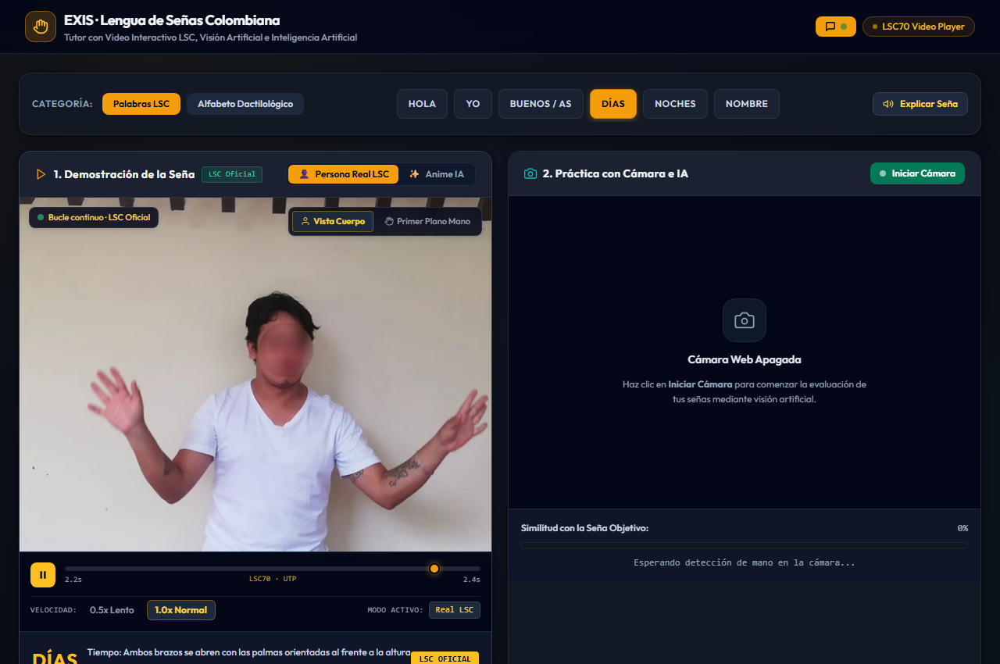

# 🤟 EXIS · Tutor Interactivo de Lengua de Señas Colombiana (LSC)

Aplicación web educativa interactiva basada en el dataset oficial **LSC70** (Universidad Tecnológica de Pereira), diseñada para la enseñanza y práctica de la Lengua de Señas Colombiana con **Demostración en Video**, **Evaluación Anatómica en Tiempo Real por Visión Artificial** y **Tutor Inteligente con IA Local**.



---

## 🌟 Características Principales

1. **Reproductor de Video Interactivo Pedagógico:**
   - Visualización fluida a **25 fps** en bucle continuo de personas reales ejecutando las señas.
   - **Vista Dual:** Alternancia instantánea entre *Vista Cuerpo Completo* y *Primer Plano Mano* (zoom enfocado en dedos y articulaciones).
   - **Control de Velocidad:** `0.5x Lento` para análisis paso a paso y `1.0x Normal`.
   - **Modo Híbrido:** Botón para alternar entre *Persona Real LSC* y *Anime IA* (con degradación elegante a video real si el clip anime está en preparación).
   - **Máxima Compatibilidad:** Salida sincronizada en video HTML5 MP4 y gemelos WebP animados.

2. **Evaluador en Vivo por Cámara Web (MediaPipe Hands):**
   - Rastreo en tiempo real de 21 puntos clave por mano.
   - Comparación angular y geométrica de la postura del estudiante contra la seña objetivo.
   - Barra de similitud en vivo (0% - 100%) y felicitación automática con confeti y síntesis de voz al alcanzar la meta.

3. **Tutor Inteligente Local con IA (Ollama):**
   - Asistente conversacional pedagógico impulsado por **Ollama** con el modelo `qwen2.5:3b`.
   - Sincronización bidireccional: Si le dices *"Quiero aprender DÍAS"* o *"Enséñame la letra B"*, el reproductor y la cámara cambian automáticamente a esa seña.
   - Funciona 100% offline sin necesidad de enviar datos a servidores externos.

---

## 🗂️ Catálogo de Señas Disponibles

| Categoría | Señas Incluidas |
| :--- | :--- |
| **Palabras LSC** | `HOLA`, `YO`, `BUENOS`, `DIAS`, `NOCHES`, `NOMBRE` |
| **Alfabeto Dactilológico** | Letras `A`, `B`, `C`, `L`, `V` |

---

## 🚀 Guía de Instalación Paso a Paso (Para tu compañero y nuevos desarrolladores)

Para que cualquier persona pueda clonar y ejecutar el proyecto en su computador desde cero:

### 1. Instalar Git y GitHub Desktop
Git es necesario para descargar y sincronizar el código del proyecto.
- **Opción A (Recomendada con Windows Terminal / PowerShell):**
  Abre PowerShell o CMD como administrador y ejecuta:
  ```powershell
  winget install --id Git.Git -e
  winget install --id GitHub.GitHubDesktop -e
  ```
- **Opción B (Descarga manual desde navegador):**
  - Descargar **Git para Windows:** [git-scm.com/download/win](https://git-scm.com/download/win)
  - Descargar **GitHub Desktop:** [desktop.github.com](https://desktop.github.com/)

---

### 2. Instalar Ollama (Tutor de IA Local)
Ollama es el motor que ejecuta el tutor inteligente en tu computador de forma local y privada.
- **Opción A (Terminal):**
  ```powershell
  winget install Ollama.Ollama -e
  ```
- **Opción B (Descarga manual):**
  - Entra a [ollama.com/download/windows](https://ollama.com/download/windows) y descarga el instalador `OllamaSetup.exe`.
  - Ejecuta el instalador y sigue los pasos en pantalla.

#### Descargar el modelo del tutor (`qwen2.5:3b`):
Una vez instalado Ollama, abre una terminal (PowerShell o CMD) y escribe:
```bash
ollama run qwen2.5:3b
```
- Esto descargará el modelo optimizado de ~1.9 GB.
- **Aceleración en GPU (NVIDIA RTX 4050 / RTX Series):** Ollama detectará automáticamente tu tarjeta gráfica y cargará el modelo en la VRAM de la GPU. Correrá a más de **100 tokens/segundo** de forma instantánea.
- Puedes probarlo haciéndole una pregunta en la terminal y luego salir escribiendo `/bye`.

---

### 3. Instalar Python (3.10 o superior)
- **Opción A (Terminal):**
  ```powershell
  winget install Python.Python.3.11 -e
  ```
- **Opción B (Descarga manual):**
  - Descarga Python desde [python.org/downloads](https://www.python.org/downloads/).
  - **MUY IMPORTANTE:** En la primera pantalla del instalador, marca la casilla que dice **"Add Python to PATH"** antes de hacer clic en *Install Now*.

---

### 4. Clonar el Repositorio y Puesta en Marcha

1. **Clonar el proyecto:**
   - **Desde GitHub Desktop:**
     Abre GitHub Desktop $\rightarrow$ menú **File** $\rightarrow$ **Clone repository...** $\rightarrow$ selecciona el repositorio compartido o pega la URL.
   - **Desde la Terminal:**
     ```bash
     git clone <URL_DEL_REPOSITORIO>
     cd exis-lenguaje-senas
     ```

2. **Ejecutar la Aplicación (1 solo clic):**
   Haz doble clic sobre el archivo:
   ```text
   iniciar_aplicacion.bat
   ```
   *(Este archivo verificará automáticamente si Ollama está activo, levantará el servidor en el puerto 8000 y abrirá tu navegador predeterminado en `http://localhost:8000/`).*

---

## 👥 Protocolo de Colaboración en Pareja (Git Workflow)

Para colaborar en pareja sin chocar ni sobreescribir código:

1. **Ramas de Trabajo:**
   - La rama `main` contiene el código funcional y verificado.
   - Cada desarrollador debe trabajar en su propia rama:
     ```bash
     # Para Abner:
     git checkout -b feature/abner-<tarea>

     # Para tu compañero:
     git checkout -b feature/amigo-<tarea>
     ```
2. **Sincronización Diaria:**
   Antes de empezar a trabajar cada día, actualiza tu copia local con:
   ```bash
   git checkout main
   git pull origin main
   ```
3. **División de Responsabilidades:**
   - Consulta el archivo [`AGENTS.md`](file:///AGENTS.md) para ver la separación de módulos y las 6 reglas duras del proyecto (archivos < 1,100 líneas, cero CSS/JS embebido en HTML, puerto 8000).

---

## 🎨 Generación de Videos Anime IA (Gemini / Kling / Runway)

En la carpeta [`referencias_para_gemini/`](file:///referencias_para_gemini/) encontrarás:
- `fotos/`: Fotogramas clave de máxima expresión de las 11 señas.
- [`PROMPTS_GEMINI.md`](file:///referencias_para_gemini/PROMPTS_GEMINI.md): Prompts listos para copiar y pegar en [gemini.google.com](https://gemini.google.com).
- Para integrar un nuevo video anime generado, simplemente guarda el archivo en:
  `app/videos/anime/<SEÑA>_body.mp4`

---

## 📄 Créditos y Licencia
- **Proyecto:** EXIS — Tutor Inteligente de Lengua de Señas Colombiana.
- **Dataset:** LSC70 (Universidad Tecnológica de Pereira).
- **Visión Artificial:** Google MediaPipe Hands.
- **Modelo de Lenguaje:** Qwen 2.5 3B vía Ollama.
